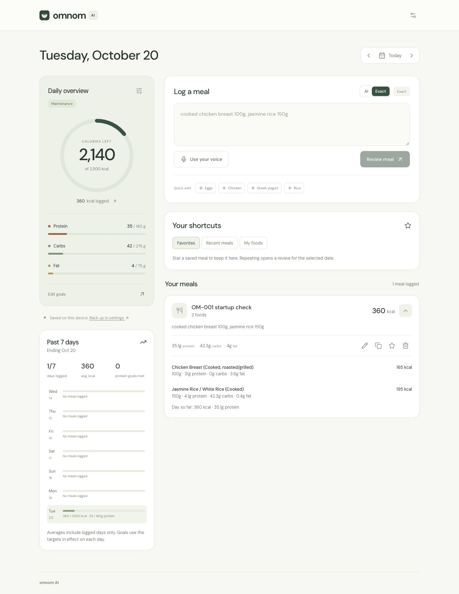

# OM-001 verification: local startup and architecture docs

Date: **October 20, 2026**. Owner: Codex. Status: **Passed** for the scoped local workflow.

Revision: `11239373c2da77dea10da4ff170903f70244f70f` plus the existing uncommitted working tree and OM-001 edits. This is not a clean-commit release certification. Existing implementation changes were present before this task; they were preserved. No production deployment or live model evaluation was performed.

Story: a developer installs dependencies, starts the documented backend/frontend, enters a synthetic meal, reviews reference nutrition through the Vite proxy, saves to the browser diary, and sees the same meal after reload.

## Changes

- Reconciled README, developer guide, agent instructions, and frontend README with browser-local persistence, server-managed AI, actual modules, current light UI, and legacy endpoint boundaries.
- Corrected Vite's proxy from port 5000 to **5027**, matching the existing backend HTTP profile. Port 5000 was occupied by macOS Control Center; that service was left untouched.
- Documented Node engine requirements from the installed Vite/plugin packages, .NET prerequisites, no-key versus live AI behavior, configuration precedence, backup scope, and current hosting definitions without asserting live deployment state.
- Kept provider model IDs/capabilities explicitly dated as code settings. Earlier live evidence remains in the intelligence review; OM-001 did not recheck provider availability.

## Environment and commands

Observed environment: macOS, .NET SDK **10.0.301**, ASP.NET Core/.NET runtime **8.0.19**, Node **24.4.0**, npm **11.4.2**, Vite **8.2.2**. Backend hosted in Development. No project dependencies were upgraded.

Executed from the repository root:

```sh
dotnet restore backend/Omnom.Api.csproj
npm --prefix frontend ci
dotnet test tests/Omnom.Tests
npm --prefix frontend test
npm --prefix frontend run build
```

| Check | Result |
|---|---|
| Backend restore | Passed; installed packages were already restored |
| Clean npm install | Passed; 181 packages installed from lockfile |
| Backend tests | 92 passed, 0 failed, 0 skipped |
| Frontend regressions | 25 passed, 0 failed, 0 skipped |
| TypeScript/production build | Passed; generated `backend/wwwroot/` synchronized |
| Documentation paths, anchors, and launch/proxy agreement | Passed |
| `git diff --check` | Passed |

The first sandboxed .NET test attempt aborted because the test runner could not bind its local communication socket. Rerunning the standard test command with local socket access succeeded. npm emitted the existing `lucide-vue-next@1.0.0` deprecation notice; migrating icons was outside OM-001.

## Isolated startup

For repeatable verification without inheriting a real OpenRouter key, server diary, or hosted database, use a temporary data directory and explicit environment overrides. These POSIX commands start the same checked-in HTTP profile used by the quickstart:

```sh
task_data_dir=$(mktemp -d /tmp/omnom-om001.XXXXXX)
OPENROUTER_API_KEY='' USDA_API_KEY=DEMO_KEY \
DATABASE_URL='' DATABASE_URL_UNPOOLED='' APP_PASSCODE='' \
PUBLIC_DIARY=true REQUIRE_PASSCODE=false DATA_DIR="$task_data_dir" \
dotnet run --project backend/Omnom.Api.csproj --launch-profile http
```

In another terminal:

```sh
npm --prefix frontend run dev -- --strictPort
```

In this run, the temporary directory was `/tmp/omnom-om001.pxlIXC`. The backend command additionally used `--no-build` after the successful test build; output was redirected to temporary logs. Neither the repository `.env` nor existing databases were edited. The loader preserves explicitly empty environment variables, preventing `.env` credentials from replacing these overrides.

Observed startup output:

```text
Now listening on: http://localhost:5027
Hosting environment: Development
VITE v8.2.2 ready
Local: http://localhost:5173/
```

Use **localhost** consistently for this workflow. Hostnames/ports are distinct browser storage origins; do not assume a numeric loopback URL shares the same diary or server binding. Stop the servers with Ctrl+C when finished. A new temporary directory gives a fresh server database; use a disposable browser profile/origin for a fresh browser diary and never clear an existing diary just to run a test.

## Flow evidence

| Boundary | Result | Observed evidence |
|---|---|---|
| Backend HTTP startup | Passed | Listened on port 5027; Swagger returned HTTP 200 |
| Frontend startup | Passed | Strict-port Vite served `http://localhost:5173`; active Omnom UI rendered |
| Client → API | Passed | Exact review of `cooked chicken breast 100g, jasmine rice 150g` returned through the configured proxy |
| API → references → review | Passed | Chicken 100 g: 165 kcal; cooked jasmine rice 150 g: 195 kcal; both labeled Reference food; meal total 360 kcal |
| Review → browser save | Passed | Named `OM-001 startup check`; time left empty; success toast; 1 meal and 360 kcal logged |
| Reload → persisted UI | Passed | Same named meal and food weights remained; 360 kcal, 35.1 g protein, 42.3 g carbs, 4 g fat; weekly view showed 1/7 logged days and 360 average kcal |
| No-key AI fallback | Passed | AI review of `150g cooked chicken breast` displayed “Used the local parser; review quantities and estimates.” and retained 150 g reference nutrition; draft discarded |
| Reference search proxy | Passed | `GET http://localhost:5173/api/foods/search?q=chicken` returned HTTP 200 and reference JSON |
| Public settings boundary | Passed | `GET http://localhost:5173/api/settings` returned HTTP 404 |
| Persistence separation | Passed | Read-only inspection of temporary SQLite showed 59 food references and **0 server MealEntries** after browser save/reload |
| Browser runtime | Passed | No captured error/warning console entries during the Exact save/reload flow |

Screenshot captured after reload with the saved meal expanded:



The synthetic saved meal was deleted through the normal UI after capture; the diary returned to zero meals. The fallback draft was discarded. Temporary dev servers were stopped after verification. The screenshot records the verified intermediate state, not a retained user meal.

## Limits and follow-up

This run validates the documented local startup and one deterministic/no-key browser workflow. It does not certify a fresh OS installation, Docker/Vercel execution, hosted PostgreSQL, browser voice permissions, live AI accuracy/free availability, cross-device sync, or the full release matrix. No AI provider requests were made in the tested workflows; Exact used local references, and the AI test had an explicitly empty key and matched a local staple.

OM-001's four acceptance criteria are satisfied by the updated docs, matching launch/proxy configuration, dependency installation, and evidence above. **OM-002** remains the next task for a broader repeatable browser release suite. **OM-004** remains responsible for live provider verification and measured AI quality.
