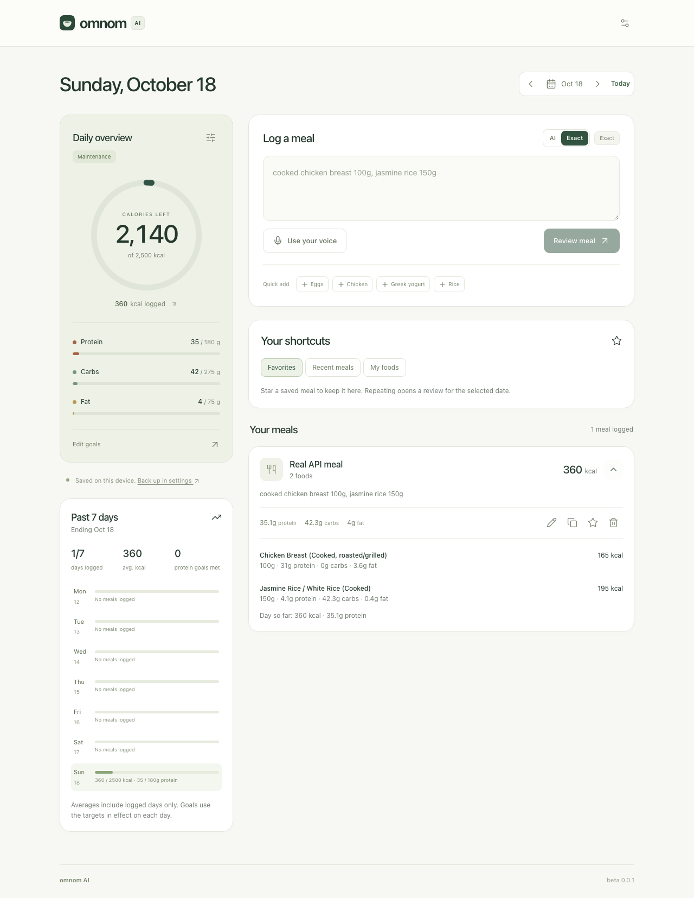
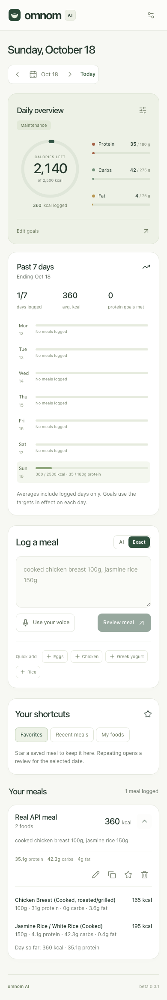

# OM-002 verification: reproducible release smoke checks

Completed **October 20, 2026**, owner Codex. Status: **Passed**. The [suite guide](../../frontend/tests/smoke/README.md) documents installation, the release checklist, isolation, and failure diagnosis. [Machine-readable results](OM-002-results.json) preserve the final run's metadata and per-scenario results.

## Result

- **18/18 browser checks passed**: nine scenarios each on desktop (1280×900) and narrow mobile (390×844). No retries, failures, or skipped scenarios.
- **92 backend tests passed**, no failures/skips.
- **25 frontend Node regressions passed**, no failures/skips.
- TypeScript/frontend production build and .NET build passed. `git diff --check` and documentation path/anchor checks passed.
- Browser run: `2026-10-20T23:07:02.123Z` through `2026-10-20T23:07:16.323Z` (UTC), about 14.1 seconds of Playwright execution. In America/Chicago this run occurred on October 20, 2026.

Source: `11239373c2da77dea10da4ff170903f70244f70f` plus the existing dirty working tree, including the new OM-002 suite. The JSON snapshot records those paths; this is not a clean-commit release claim. Runtime build version remained **beta 0.0.1**. This task did not create a deployment or consume beta 0.0.2.

Environment: macOS arm64, Node v24.4.0, .NET SDK 10.0.301, Playwright 1.64.1, Chromium 156.0.8078.4, timezone America/Chicago, locale en-US. The app clock is pinned to October 20, 2026 noon Chicago time for deterministic dates.

## Commands

From the repository root:

```sh
npm --prefix frontend install --save-dev @playwright/test
npm --prefix frontend run test:smoke:install
npm --prefix frontend test
dotnet test tests/Omnom.Tests --no-restore
npm --prefix frontend run test:smoke
```

The dependency install updated the package/lockfile with Playwright. Future runs should use `npm --prefix frontend ci` rather than reinstalling a newer dependency version. The browser setup downloads the revision required by the lockfile. `test:smoke` builds the frontend and backend before running tests.

An initial run could not launch because the newly installed Playwright required a different Chromium revision than the existing cache. Installing the matching browser resolved that prerequisite. Initial suite runs also exposed test locator ambiguity (library and meal actions share names), a double-click assumption during date-control layout changes, and an incorrect test POST path. These were corrected to target the actual controls/routes. Final results are from the complete passing matrix, not a collection of individually successful reruns. An explicit graceful SIGTERM shutdown was also added after an external cleanup check detected that Playwright’s default forced termination left the temporary database behind. The final run verified its database directory was removed. No application behavior was changed to accommodate test assertions.

The evidence reporter was separately exercised with a synthetic skipped scenario and a nominally passing aggregate result: it returned `failed`. `forbidOnly` also prevents focused tests from silently excluding the rest of the suite. The gate requires every scenario to pass.

## Verified boundaries

| Scenario | Evidence |
|---|---|
| Real packaged frontend → API → SQLite references → review → browser save/reload | Exact chicken/rice produced 100/150 g and 360 kcal; every returned food field persisted, time stayed optional, and selected date remained correct |
| Public/private endpoint protection | Real HTTP GET and POST requests to the actual legacy diary/target/settings/auth routes returned 404; food search and Exact parsing remained usable |
| Replacement and source integrity | Stubbed chicken replacement with synthetic lentils updated grams, calories, protein, carbs, fat, fiber, reference ID, FDC ID and match status; defaults survived reload |
| Reuse/edit/Undo | Favorite snapshots survived original edits; repeat, recent meal review, edit/delete/save Undo, insertion order and original dates updated daily/weekly totals correctly |
| Remembered portions | An unresolved alias reused 150 g; an explicit 200 g overrode that default; totals survived reload |
| Historical goals and missing logs | Same-day edits used the latest target without rewriting earlier dates; missing days stayed unlogged; rapid previous-day navigation showed the intended diary |
| Backup round trip | Exported meals, targets, favorites/defaults and provenance round-tripped; older version-1 imports remained readable; invalid/oversized files preserved original data |
| Storage failures | Injected quota failures rejected save/restore without false success; corrupt data was not cleared and remained exportable; blocked reads surfaced an error |
| Feedback/accessibility/responsiveness | Parse loading/failure and reference-search errors left controls usable; dialogs trapped focus and supported Escape/focus return; named controls and horizontal layout were checked on both viewports |

Uncaught browser exceptions fail each test. The real API scenario uses known local references in Exact mode. Other cases stub browser parse/reference responses with explicitly synthetic records/IDs. Browser requests outside loopback are blocked. No AI provider requests or live USDA lookups were made.

## Isolation and artifacts

The harness served the built SPA from a dedicated .NET process at `http://127.0.0.1:5187`, with a fresh temporary SQLite directory and explicit empty OpenRouter/hosted database/PIN overrides. It refused existing-server reuse. Every test ran in a new Chromium context; normal reloads read persisted test data without reseeding it. Existing repository databases, provider credentials, production data, and personal browser diaries were not edited. The temporary backend shut down after the run, and a post-run assertion confirmed that its SQLite directory no longer existed. Git, Docker, and Vercel ignore the transient `.smoke` report directory.

Transient HTML/JSON reports, traces, failure screenshots, downloads, and server output stay under ignored `frontend/.smoke/`. The saved JSON and screenshots here are synthetic evidence from the final passing run. Fresh executions overwrite local reports; preserve the dated evidence relevant to an authorized release.

Desktop after a real-API save/reload:



Narrow mobile after the same flow:



## Limits and next step

This is Chromium desktop/mobile viewport coverage, not a Safari/WebKit or physical-device certification. Stubbed failure/default/search cases verify contracts and persistence rather than live model quality. Existing Node tests deterministically exercise stale timeline promises/errors; browser tests cover rapid rendered navigation. Hosted PostgreSQL, voice permissions, deployment protection, cross-device sync, and live provider availability are outside this run. No deployment occurred.

OM-002's six acceptance criteria are complete. **OM-003** is next: build the representative meal evaluation corpus and runner; OM-004 remains the live accuracy/latency baseline.
